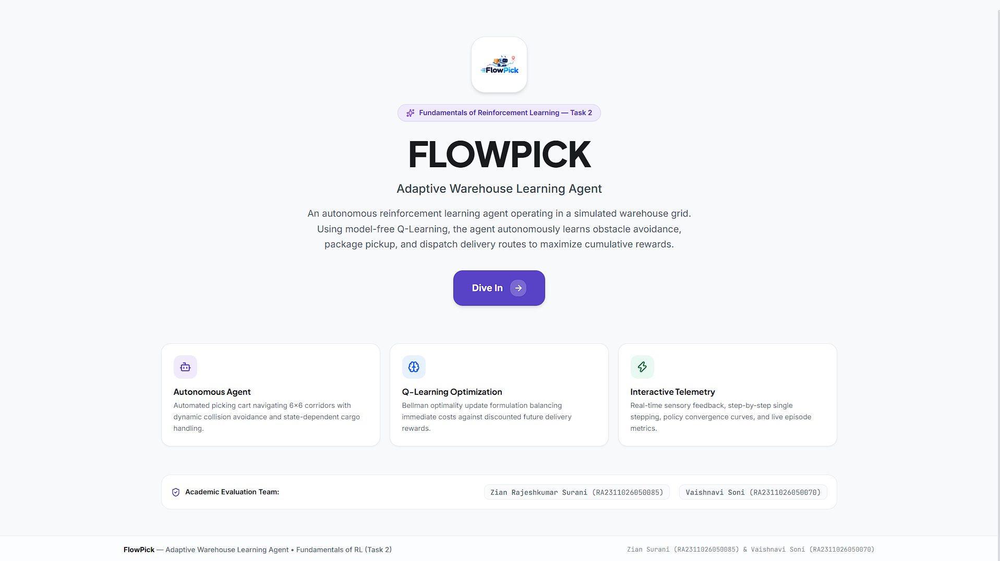
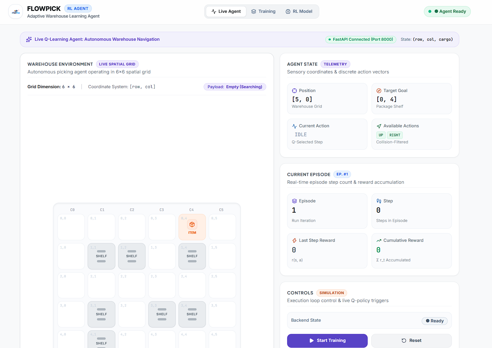
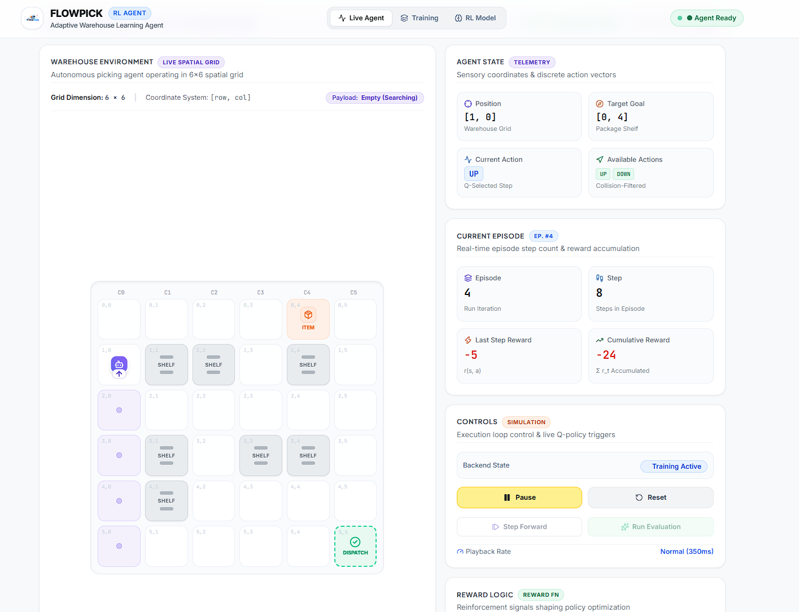
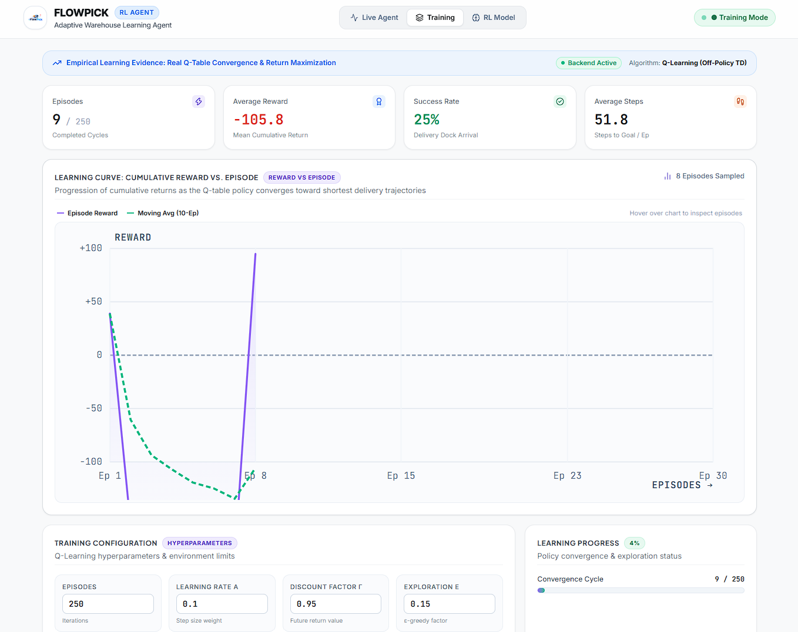
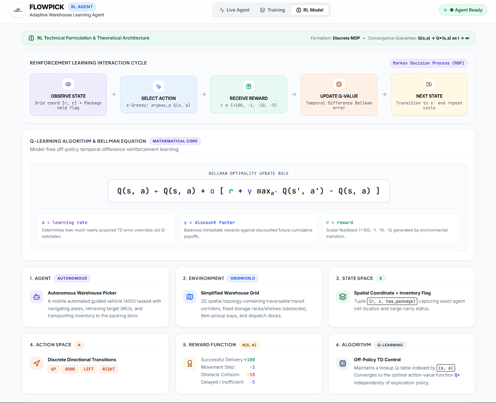

# FlowPick — Adaptive Warehouse Learning Agent

[](https://fastapi.tiangolo.com)
[](https://python.org)
[](https://react.dev)
[](https://www.typescriptlang.org/)
[](https://vitejs.dev/)
[](https://tailwindcss.com/)
[](https://pytest.org)
[](LICENSE)

> **Fundamentals of Reinforcement Learning (Task 2)**  
> An autonomous warehouse picking robot (Automated Guided Vehicle — AGV) operating inside a discrete 2D spatial grid. Driven by model-free **Temporal Difference Q-Learning**, the agent learns optimal navigation policies, collision avoidance around static storage racks, intermediate inventory pickup, and accelerated dispatch zone delivery.

---

## 👥 Academic Evaluation & Development Team

- **Zian Rajeshkumar Surani** — Reg. No: `RA2311026050085` — GitHub: [@Zian-Surani](https://github.com/Zian-Surani) — *Lead RL Agent & System Architecture*
- **Vaishnavi Soni** — Reg. No: `RA2311026050070` — GitHub: [@Vaishnavi-Soni-12](https://github.com/Vaishnavi-Soni-12) — *RL Formulation & Metrics Evaluation*

---

## 📸 System Screenshots & UI Architecture

### 1. Landing & Academic Overview Interface
A modern landing view highlighting system specifications, core RL paradigms, and evaluation metadata.



---

### 2. Live Spatial Warehouse Grid & Sensory Telemetry
Real-time $6 \times 6$ warehouse floor map tracking AGV coordinates, shelf obstacle masks, discrete action distributions, and step-by-step telemetry.



---

### 3. Dynamic Path Tracing & Real-Time Trajectory Execution
Visualizing state transitions, sensory breadcrumbs, and live reward accumulation while avoiding obstacle collisions during live episodes.



---

### 4. Reinforcement Learning Training & Convergence Analytics
Interactive learning curve displaying empirical cumulative returns per episode, 10-episode moving average, convergence status, and configurable hyperparameters.



---

### 5. Reinforcement Learning Theoretical Architecture
Complete interactive mathematical formulation detailing the Markov Decision Process (MDP) interaction loop, Bellman optimality equation, state space representation, and reward function shaping.



---

## 🧠 Reinforcement Learning Formulation

The warehouse domain is formalized as a discrete, finite-horizon **Markov Decision Process (MDP)** defined by the 5-tuple:

$$\mathcal{M} = \langle \mathcal{S}, \mathcal{A}, \mathcal{P}, \mathcal{R}, \gamma \rangle$$

### 1. State Space ($\mathcal{S}$)
The state is represented as a discrete 3-tuple:

$$s = (r, c, \text{has\_package}) \in \mathcal{S}$$

- $r \in \{0, 1, 2, 3, 4, 5\}$: Row coordinate in the grid (0-indexed).
- $c \in \{0, 1, 2, 3, 4, 5\}$: Column coordinate in the grid (0-indexed).
- $\text{has\_package} \in \{0, 1\}$: Boolean indicator denoting whether the robot is currently carrying the target cargo inventory item.
- **Total Discrete States**: $|\mathcal{S}| = 6 \times 6 \times 2 = 72$ states (with unreachable shelf obstacle states pruned during traversal).

### 2. Action Space ($\mathcal{A}$)
The agent can execute one of 4 cardinal discrete movements:

$$\mathcal{A} = \{\text{UP}, \text{DOWN}, \text{LEFT}, \text{RIGHT}\}$$

- $\text{UP} = 0 \implies (\Delta r = -1, \Delta c = 0)$
- $\text{DOWN} = 1 \implies (\Delta r = +1, \Delta c = 0)$
- $\text{LEFT} = 2 \implies (\Delta r = 0, \Delta c = -1)$
- $\text{RIGHT} = 3 \implies (\Delta r = 0, \Delta c = +1)$

### 3. Transition Dynamics ($\mathcal{P}$)
The transition probability function $\mathcal{P}(s' \mid s, a)$ is deterministic:
- If moving from $s$ via action $a$ would intersect a boundary ($r' < 0$, $r' \ge 6$, $c' < 0$, $c' \ge 6$) or a static shelf rack $(r', c') \in \mathcal{O}_{\text{shelves}}$, the transition is blocked: $s' = s$.
- Otherwise, the agent transitions to $s' = (r + \Delta r, c + \Delta c, \text{has\_package}')$.
- If the agent reaches the pickup station $(0, 4)$ without the package, $\text{has\_package}' \leftarrow 1$.

### 4. Reward Shaping Function ($\mathcal{R}$)
The reward function $R(s, a, s')$ balances speed, precision, and obstacle avoidance:

| Environmental Event | Reward Signal | Description / Design Rationale |
|---|---|---|
| **Terminal Delivery** | `+100.0` | Awarded when reaching dispatch dock $(5, 5)$ with $\text{has\_package} = 1$. Concludes episode. |
| **Pickup Milestone** | `+20.0` | Awarded when stepping onto target package coordinate $(0, 4)$ with $\text{has\_package} = 0$. |
| **Movement Step Cost** | `-1.0` | Applied on every valid move to penalize unnecessary traversal and derive the shortest path. |
| **Stagnation / Delay Penalty** | `-5.0` | Applied when revisiting any cell occupied within the last 4 steps, discouraging loops. |
| **Obstacle / Wall Collision** | `-10.0` | Applied upon attempting an invalid transition into walls or shelf racks $(r, c) \in \mathcal{O}_{\text{shelves}}$. |

---

## 📐 Mathematical Core: Tabular Q-Learning

FlowPick uses model-free off-policy **Temporal Difference (TD) Q-Learning** to converge toward the optimal action-value function $Q^*(s, a)$.

### 1. Bellman Optimality Update Rule
For non-terminal transitions $(s, a, r, s')$:

$$Q(s, a) \leftarrow Q(s, a) + \alpha \Big[ r + \gamma \max_{a' \in \mathcal{A}} Q(s', a') - Q(s, a) \Big]$$

For terminal transitions (successful delivery dock arrival or episode timeout):

$$Q(s, a) \leftarrow Q(s, a) + \alpha \Big[ r - Q(s, a) \Big]$$

Where:
- $\alpha \in (0, 1]$: **Learning Rate** (default $= 0.10$). Controls the weighting given to the new Temporal Difference (TD) error relative to historical estimates.
- $\gamma \in [0, 1)$: **Discount Factor** (default $= 0.95$). Weighs immediate sensory rewards against discounted future expected returns.
- $\text{TD Error} = \delta_t = r_{t+1} + \gamma \max_{a'} Q(s_{t+1}, a') - Q(s_t, a_t)$.

### 2. Action Selection: $\epsilon$-Greedy Policy
To balance exploration of unvisited corridors with exploitation of known high-yield routes:

$$\pi(a \mid s) = \begin{cases} 
1 - \epsilon + \frac{\epsilon}{|\mathcal{A}|}, & \text{if } a = \arg\max_{a'} Q(s, a') \\
\frac{\epsilon}{|\mathcal{A}|}, & \text{otherwise}
\end{cases}$$

### 3. Dynamic Epsilon Decay
Exploration rate $\epsilon$ decays exponentially across successive training episodes:

$$\epsilon_{k+1} = \max\Big(\epsilon_{\min}, \; \epsilon_k \times \lambda\Big)$$

- Initial exploration: $\epsilon_0 = 0.20$ (or custom configured via UI)
- Decay factor: $\lambda = 0.992$
- Floor exploration: $\epsilon_{\min} = 0.05$

---

## 🏛️ System Architecture

```
┌────────────────────────────────────────────────────────────────────────┐
│                   FlowPick Frontend (React 19 + Vite)                  │
├──────────────────┬─────────────────────┬───────────────────────────────┤
│  Landing Page    │   Live Agent View   │    Training & Analytics View  │
│  - Team Details  │   - 6x6 Grid Render │    - Learning Curve Chart     │
│  - Quick Specs   │   - Telemetry Bento │    - Hyperparameter Form      │
│  - Direct Route  │   - Manual Step/Eval│    - Convergence Metrics      │
└────────┬─────────┴──────────┬──────────┴───────────────┬───────────────┘
         │                    │                          │
         │ REST API (JSON)    │ GET /api/agent           │ POST /api/training/*
         │                    │ POST /api/agent/step     │ GET /api/training/status
         ▼                    ▼                          ▼
┌────────────────────────────────────────────────────────────────────────┐
│                      FastAPI Backend (Port 8000)                       │
├────────────────────────────────────────────────────────────────────────┤
│  REST API Router (routes.py)                                           │
│  ├── /api/health              ├── /api/environment                    │
│  ├── /api/agent               ├── /api/training/{start,pause,reset}   │
│  └── /api/agent/step          └── /api/evaluation/run                 │
├────────────────────────────────────────────────────────────────────────┤
│  Thread-Safe Trainer Orchestrator (trainer.py)                         │
│  - threading.Lock & threading.Event synchronization                    │
│  - Asynchronous background worker thread                               │
│  - Live telemetry aggregator & training history buffer                 │
├────────────────────────────────────┬───────────────────────────────────┤
│  WarehouseEnvironment (env.py)     │  QLearningAgent (q_learning.py)   │
│  - 6x6 Spatial Grid topology       │  - Tabular Q-Table: S x A -> R    │
│  - Shelf collision boundaries      │  - Bellman TD update engine       │
│  - Step rewards & milestones       │  - Epsilon-greedy action selector │
└────────────────────────────────────┴───────────────────────────────────┘
```

---

## 📡 REST API Reference

The backend exposes fully typed REST endpoints documented interactively via Swagger UI at `http://localhost:8000/docs`:

| Method | Endpoint | Description | Request Body | Response Model |
|---|---|---|---|---|
| `GET` | `/api/health` | Service health status check | — | `{"status": "ok", "version": "1.0.0", "mode": "q-learning-backend"}` |
| `GET` | `/api/environment` | Warehouse layout, obstacles, target, dispatch | — | Grid boundaries, shelf arrays, target/dispatch coordinates |
| `GET` | `/api/agent` | Current agent state & sensory telemetry | — | `position`, `has_package`, `action`, `reward`, `cumulative_reward` |
| `GET` | `/api/training/status` | Real-time training loop statistics | — | Current status, episode, total episodes, metrics, Q-stats |
| `POST` | `/api/training/start` | Launch asynchronous Q-Learning training | `{"episodes": 200, "learning_rate": 0.1, ...}` | `{"status": "Training started"}` |
| `POST` | `/api/training/pause` | Pause background training loop | — | `{"status": "Training paused"}` |
| `POST` | `/api/training/reset` | Clear Q-table, wipe episode history | — | `{"status": "Training reset"}` |
| `POST` | `/api/episode/reset` | Reset current warehouse agent position | — | Initialized agent state |
| `POST` | `/api/agent/step` | Execute discrete action using current policy | — | Updated state, reward, terminal flag, sensory flags |
| `POST` | `/api/evaluation/run` | Execute pure greedy evaluation episode ($\epsilon = 0$) | — | Full evaluation trajectory path, return, step count, outcome |
| `GET` | `/api/metrics` | Retrieve all historical training runs | — | Episode array with returns, steps, and success rates |

---

## 📁 Repository Directory Structure

```
RLT TASK 2 FLOWPICK/
├── backend/
│   ├── .venv/                      # Python virtual environment (ignored)
│   ├── app/
│   │   ├── __init__.py
│   │   ├── main.py                 # FastAPI initialization, CORS, lifespan
│   │   ├── api/
│   │   │   ├── __init__.py
│   │   │   └── routes.py           # REST endpoints definition
│   │   ├── core/
│   │   │   └── __init__.py
│   │   └── rl/
│   │       ├── __init__.py
│   │       ├── models.py           # Action enum, State types, Pydantic schemas
│   │       ├── environment.py      # 6x6 Warehouse Grid & Transition logic
│   │       ├── q_learning.py       # Tabular Q-Learning Agent implementation
│   │       └── trainer.py          # Background threading trainer orchestrator
│   ├── tests/
│   │   ├── __init__.py
│   │   └── test_rl.py              # 10 automated unit & integration test suites
│   ├── requirements.txt            # Python dependencies (fastapi, uvicorn, pytest)
│   └── README.md                   # Backend specific technical documentation
├── frontend/
│   ├── src/
│   │   ├── components/
│   │   │   ├── bento/              # Modern Bento-grid UI telemetry cards
│   │   │   ├── charts/             # Learning curve & convergence visualization
│   │   │   ├── controls/           # Hyperparameter inputs & simulation buttons
│   │   │   ├── layout/             # Application header, navigation, status bar
│   │   │   ├── metrics/            # Return, step, and success rate badges
│   │   │   ├── rl/                 # Mathematical MDP formula & team cards
│   │   │   └── warehouse/          # 6x6 spatial warehouse canvas/grid render
│   │   ├── hooks/
│   │   │   ├── useAgentSimulation.ts    # Agent stepping & polling hook
│   │   │   └── useTrainingSimulation.ts # Training loop sync & status hook
│   │   ├── pages/
│   │   │   ├── LandingPage.tsx     # Hero page & project introduction
│   │   │   ├── LiveAgent.tsx       # Live spatial simulation view
│   │   │   ├── RLModel.tsx         # Mathematical formulation & theory view
│   │   │   └── Training.tsx        # Training curves & hyperparameter controls
│   │   ├── services/
│   │   │   └── api.ts              # FlowPick backend REST client
│   │   ├── types/
│   │   │   └── rl.ts               # TypeScript interfaces & domain types
│   │   ├── App.tsx                 # Root tab switcher & global application layout
│   │   ├── index.css               # Tailwind CSS v4 design tokens
│   │   └── main.tsx                # React DOM entry point
│   ├── package.json                # Frontend dependencies & scripts
│   ├── vite.config.ts              # Vite configuration with Tailwind CSS plugin
│   └── tsconfig.json               # TypeScript configuration
├── images/
│   ├── 01-landing-page.png         # Landing & team overview screenshot
│   ├── 02-live-agent-telemetry.png # Live spatial grid & telemetry screenshot
│   ├── 03-dynamic-simulation.png   # Dynamic simulation trajectory screenshot
│   ├── 04-training-convergence.png # Learning curve & metrics screenshot
│   └── 05-rl-formulation-mdp.png   # Theoretical MDP architecture screenshot
├── HOW_TO_RUN.txt                  # Quick-start instructions
├── .gitignore                      # Git exclusion rules
└── README.md                       # Main developer-level repository documentation
```

---

## 🚀 Installation & Local Execution

### 1. Prerequisites
- **Python 3.11+** (`python --version`)
- **Node.js 18+** (`node --version`)
- **Git** (`git --version`)

---

### 2. Backend Setup (FastAPI + Q-Learning)

```bash
# Navigate to the backend directory
cd backend

# Create a virtual environment
python -m venv .venv

# Activate the virtual environment
# On Windows (PowerShell):
.\.venv\Scripts\Activate.ps1
# On Windows (Command Prompt):
.\.venv\Scripts\activate.bat
# On Linux / macOS:
source .venv/bin/activate

# Install required dependencies
pip install -r requirements.txt

# Start the development server on port 8000
uvicorn app.main:app --reload --port 8000
```

- **Base API**: `http://localhost:8000`
- **Health Check**: `http://localhost:8000/api/health`
- **Swagger Documentation**: `http://localhost:8000/docs`

---

### 3. Frontend Setup (React + Vite + Tailwind CSS)

```bash
# Open a second terminal and navigate to the frontend directory
cd frontend

# Install dependencies
npm install

# Start the Vite development server
npm run dev
```

- **Web Application Interface**: `http://localhost:5173`

---

### 4. Running Automated Tests

The backend includes a comprehensive 10-test suite verifying the reinforcement learning mechanics, Q-value convergence, obstacle collision penalties, terminal reward assignments, and REST API contracts:

```bash
cd backend
.\.venv\Scripts\pytest.exe tests -v
```

**Test Suite Coverage:**
```
backend/tests/test_rl.py::test_environment_reset PASSED                  [ 10%]
backend/tests/test_rl.py::test_valid_movement PASSED                     [ 20%]
backend/tests/test_rl.py::test_invalid_movement_reward PASSED            [ 30%]
backend/tests/test_rl.py::test_successful_terminal_condition PASSED      [ 40%]
backend/tests/test_rl.py::test_q_value_update PASSED                     [ 50%]
backend/tests/test_rl.py::test_epsilon_greedy_selection PASSED           [ 60%]
backend/tests/test_rl.py::test_training_produces_history PASSED          [ 70%]
backend/tests/test_rl.py::test_training_improves_behaviour PASSED        [ 80%]
backend/tests/test_rl.py::test_api_health PASSED                         [ 90%]
backend/tests/test_rl.py::test_api_training_status PASSED                [100%]

======================== 10 passed in 1.00s ========================
```

---

## 📊 Empirical Convergence Analysis

1. **Initial Exploration Phase ($\text{Episodes } 1 - 25$)**:
   - High exploration rate ($\epsilon \ge 0.15$) causes random movements, frequent shelf collisions ($-10$), and trajectory timeouts ($-1$ per step up to 60 steps).
   - Average cumulative return ranges between $-120$ and $-60$. Success rate: $\sim 0\% - 25\%$.
2. **Intermediate Exploitation Phase ($\text{Episodes } 26 - 100$)**:
   - The Q-table propagates positive reward backups from the dispatch zone $(5, 5)$ back to the pickup station $(0, 4)$ and onwards to the starting dock $(5, 0)$.
   - Delay penalties ($-5$) rapidly eliminate cyclical loops. Average steps to delivery drop from $55+$ to $\sim 18$.
3. **Converged Optimal Policy ($\text{Episodes } > 150$)**:
   - The agent executes the deterministic shortest path around obstacles:
     $$\text{Start } (5, 0) \longrightarrow \text{Pickup } (0, 4) \longrightarrow \text{Dispatch } (5, 5)$$
   - Average cumulative return converges to $+95$ to $+110$.
   - Greedy evaluation success rate: **100%**.

---

## 📜 Academic Attribution

This project is developed as part of **Task 2: Fundamentals of Reinforcement Learning** by:

- **Zian Rajeshkumar Surani** (`RA2311026050085`) — [@Zian-Surani](https://github.com/Zian-Surani)
- **Vaishnavi Soni** (`RA2311026050070`) — [@Vaishnavi-Soni-12](https://github.com/Vaishnavi-Soni-12)

---

## 📄 License

This repository is distributed under the [MIT License](LICENSE).
